# 👋 Hi, I'm <a href="https://github.com/dikawp/"></a>. Welcome to my GitHub Profile
[](https://instagram.com/dikawp_16) [](https://linkedin.com/in/ramadika-wijaya-poetra-s-9b9b74221) 

<table>
  <tr>
    <td width="65%" align="center" valign="top">
      
      
    </td>
    <td width="30%" align="center" valign="middle">
      
    </td>
  </tr>
</table>

# 👦 About Me
```go
var dikawp = map[string]any{
    "name":     "Ramadika Wijaya P.S",
    "pronouns": "he/him",
    "location": "Surabaya, Indonesia",
    "role":     "Back-End Developer",
    "focus":    "Web Development",

    "techStack": map[string][]string{
        "languages":  {"PHP", "C#", "Go", "JavaScript", "Python"},
        "frameworks": {"Laravel", ".NET", "Vue", "Next.js", "Elysia.js"},
        "databases":  {"MySQL", "PostgreSQL", "Firebase", "Supabase"},
        "tools":      {"Git", "Docker", "Postman", "Apidog"},
    },

    "website": "https://dikawp.my.id/",
    "email":   "ramadika380@gmail.com",
}
```
<picture>
  <source media="(max-width: 768px)" srcset="https://raw.githubusercontent.com/dikawp/dikawp/main/assets/sections/tech.svg" />
  
</picture>

<picture>
  <source media="(max-width: 768px)" srcset="https://raw.githubusercontent.com/dikawp/dikawp/main/assets/content/tech.svg" />
  
</picture>

<picture>
  <source media="(max-width: 768px)" srcset="https://raw.githubusercontent.com/dikawp/dikawp/main/assets/sections/ai.svg" />
  
</picture>

<picture>
  <source media="(max-width: 768px)" srcset="https://raw.githubusercontent.com/dikawp/dikawp/main/assets/content/ai-orbit.svg" />
  
</picture>


## 📊 Github Stats  
<div align="center">
  
  
  
</div>

